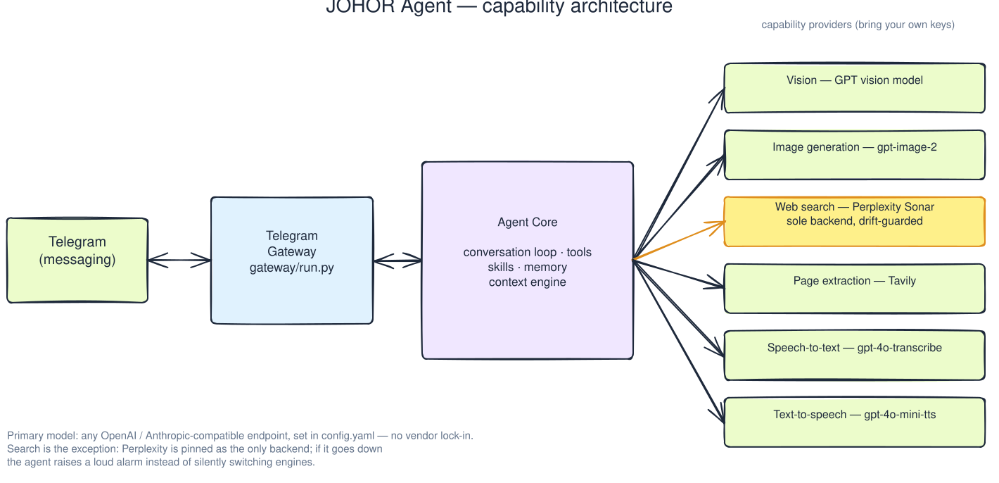
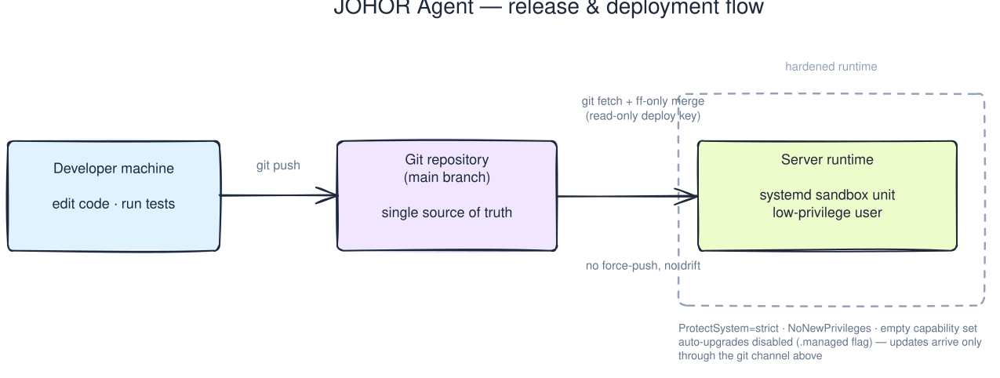

# JOHOR Agent

JOHOR Agent is a personal AI assistant that lives on Telegram and serves exactly one designated user. It combines conversation, vision, image generation, live web search, and two-way voice (listen and speak) in a single self-hosted stack that you fully control.



- **Chat & reasoning** — works with any OpenAI- or Anthropic-compatible endpoint you configure; no vendor lock-in
- **Vision** — GPT vision models understand photos the user sends
- **Image generation** — `gpt-image-2`
- **Live web search** — **Perplexity (Sonar) is the one and only search backend**, pinned by config with a drift guard: if it is unavailable for any reason the agent raises a loud error instead of silently falling back to another engine
- **Page extraction** — Tavily
- **Speech-to-text** — `gpt-4o-transcribe`
- **Text-to-speech** — `gpt-4o-mini-tts`
- **Context engine** — a built-in compressor keeps long conversations affordable

> Why pin search to Perplexity only? Because this agent researches and decides on behalf of a real person. The hallucination rate of free or low-quality search backends is unacceptable, so search quality is a hard constraint here: fail loudly, never degrade silently.

## How it works

```
Telegram <-> Gateway <-> Agent Core <-> capability providers
```

The gateway receives Telegram updates and drives the agent's conversation loop: tools, skills, memory, and the context engine. Capability providers (vision, image generation, search, extraction, speech) plug in behind the core, each with its own key — bring your own keys, keep them in `config.yaml` + environment variables, and never commit them.

## Install

Run the installer for your platform from a clone of this repo:

- **Linux / macOS / Termux** — `scripts/install.sh` (uses [uv](https://docs.astral.sh/uv/) to provision Python and dependencies)
- **Windows** — `scripts/install.ps1` in PowerShell (same flow, native Windows support)

Both scripts create an isolated environment, install the agent with its dependencies, and run first-time setup. They also accept flags (`--no-venv`, `--skip-setup` / `-NoVenv`, `-SkipSetup`) for custom setups.

## Deployment



JOHOR Agent is designed to run as a hardened, low-maintenance systemd service on your own Linux server:

- **systemd unit**, run as a dedicated low-privilege user
- **Kernel-level sandbox** (enforced, not advisory):
  - `ProtectSystem=strict` + `ReadWritePaths=$HOME` — whole filesystem read-only except the agent user's home
  - `ProtectHome=read-only`, `NoNewPrivileges=yes`, empty `CapabilityBoundingSet`, seccomp `@system-service`
  - Private mount namespace
- **No self-upgrades** — managed-marker file + unit environment flag disable both the CLI and in-chat upgrade paths; the only upgrade path is you pushing to `main` and the server fast-forwarding
- **Upgrade path** — dev machine → `git push` → server pulls with a read-only deploy key and restarts the unit

## Repository layout

```
agent/    core conversation loop and auxiliary clients
gateway/  Telegram gateway (run.py)
tools/    tool implementations (web_tools.py etc.)
plugins/  built-in plugins, incl. the context engine
skills/   skill documents
tests/    test suite
```

## Differences from upstream

This project was forked as a working-tree snapshot of [NousResearch/hermes-agent](https://github.com/NousResearch/hermes-agent) 0.13.0 (single-commit baseline, no shared git history) and evolves on its own. The baseline already contains these customizations:

1. `tools/web_tools.py` — plugin provider registry fallback in `_is_backend_available` (fixes Perplexity being silently dropped)
2. `tools/web_tools.py` — drift alarm in `_get_capability_backend` (pinned search backend unavailability raises loudly)
3. `agent/title_generator.py` — `max_tokens` 500 → 1500 (reasoning-mode endpoints consume small budgets)
4. `plugins/context_engine/cursor_style/` — custom context compression engine

## License

Licensed under **GPL-3.0** ([LICENSE](LICENSE)).

This project is based on a working-tree snapshot of hermes-agent 0.13.0 (MIT License, Copyright (C) 2025 Nous Research). The upstream license is preserved verbatim in [LICENSE.upstream-mit](LICENSE.upstream-mit). Thanks to Nous Research for the open-source work.

```
JOHOR Agent — a personal Telegram agent
Copyright (C) 2026 thiswind

This program is free software: you can redistribute it and/or modify
it under the terms of the GNU General Public License as published by
the Free Software Foundation, either version 3 of the License, or
(at your option) any later version.
```

---

## اقرأ هذا بالعربية

هل تريد معلومات عن الوكيل JOHOR؟ الوكيل الشخصي على تيليجرام — الدردشة، الرؤية، توليد الصور، البحث المباشر في الويب عبر Perplexity فقط، والصوت في اتجاهين (استماع وتحدث). يعمل كخدمة systemd مُحصَّنة على خادمك الخاص، ويخضع لسياق مُدارة بعناية.

راجع الملف [README.ar.md](README.ar.md) للنسخة العربية الكاملة.

---

*JOHOR Agent — one user, one agent, full control.*
